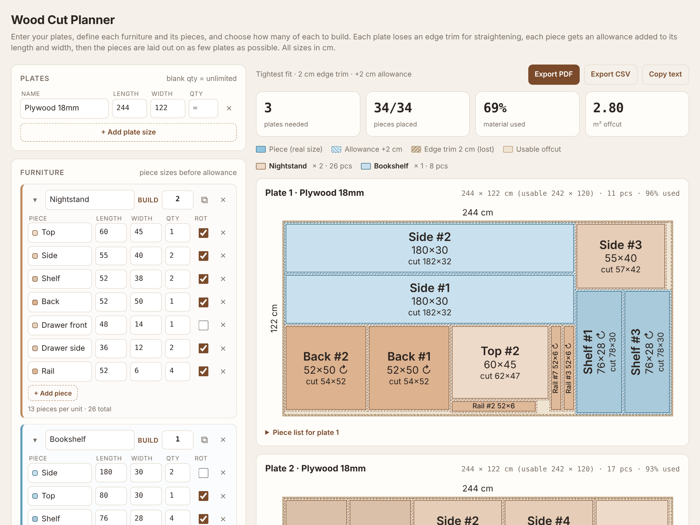

# 🪵 Wood Cut Planner

**Plan your cuts before you touch the saw.** Describe your furniture and your sheet goods, and Wood Cut Planner lays every piece out on as few plates as possible. It then gives you a printable cut plan.

**▶ Live site: https://a2k123.github.io/wood-cut-planner/**



---

## What it does

- **Plans by furniture, not by loose parts.** Define a nightstand, a bookshelf or a stool with its pieces, then choose how many of each to build. The planner multiplies everything out for you.
- **Accounts for real-world waste.**
  - **Edge trim:** every plate loses a strip when you straighten its edges. The default is 2 cm off the length and the width, and only the usable area is packed.
  - **Allowance:** a margin added to each piece's length and width, 2 cm by default, so you can trim to final size.
  - **Saw kerf:** an optional gap for the width of the blade.
- **Respects grain direction.** Untick *Rot* on a piece to keep its length along the plate's length.
- **Supports two layout styles:**
  - **Tightest fit:** any arrangement that saves the most material.
  - **Straight through-cuts only:** every cut runs edge to edge, which is what a table saw or panel saw needs.
- **Makes clear drawings.** Each plate shows the real piece (solid), the allowance (striped band), the edge trim (hatched frame) and the usable offcut. Pieces too small to label get a letter, explained in a key under the plate.
- **Handles several plate sizes.** Mix plate types and limit how many of each you have. It warns you if a piece doesn't fit or you run out of plates.

## Exports

| Button | What you get |
|---|---|
| **Export PDF** | An A4 landscape cut plan. Page 1 has a summary and a full parts list. Then there is one page per plate with its sketch and the pieces on it. |
| **Export CSV** | One row per piece: plate, furniture, piece, real size, cut size, position, rotation. It opens in Excel and Google Sheets. |
| **Copy text** | A plain-text cut list for pasting into a message. |
| **Save furniture as CSV** | Your furniture designs, so you can keep your work or share it. |
| **Import furniture CSV** | Load saved designs, replacing what you have or adding to it. |

Hebrew (and other right-to-left) names display correctly on screen, in the PDF and in Excel.

## Furniture CSV format

Each row is one piece. Rows with the same furniture name are grouped together.

```csv
Furniture,Build,Piece,Length (cm),Width (cm),Qty,Can rotate
Nightstand,2,Top,60,45,1,yes
Nightstand,2,Side,55,40,2,yes
Nightstand,2,Drawer front,48,14,1,no
Bookshelf,1,Side,180,30,2,no
Bookshelf,1,Shelf,76,28,4,yes
```

- **Build** is how many of that furniture to make. **Qty** is per one piece of furniture.
- Commas or semicolons both work, so Excel files from any region import fine. Decimal commas (`4,5`) work too.
- Hebrew column headers are recognized: `רהיט, כמות רהיטים, חלק, אורך, רוחב, כמות, סיבוב`.

## How it works

The whole app is a single `index.html` file, with no build step and no server.

- **Packing:** two methods are used, depending on the layout style.
  - **Tightest fit** uses the *MaxRects* method.
  - **Straight through-cuts** uses a *guillotine* method, which splits the remaining space in two after every cut.
- **Search:** the planner tries many piece orders, placement rules and split rules. It keeps the layout that uses the fewest plates, then the least material. Among equal options, it prefers the one that leaves one large usable offcut.
- **Drawing:** plates are drawn as SVG.
- **PDF:** pages are drawn on a canvas, so right-to-left text always renders correctly, then packed into a PDF with [jsPDF](https://github.com/parallax/jsPDF).
- **Privacy:** your data stays in your browser's local storage. Nothing is uploaded anywhere.

## Run it locally

Download `index.html` and open it in any modern browser. That's it.

To host your own copy, put `index.html` on any static host, such as GitHub Pages, Netlify or Cloudflare Pages.

## Feedback

Found a bug or have an idea? [Open an issue](https://github.com/a2k123/wood-cut-planner/issues). Suggestions from people who actually cut wood are especially welcome.
